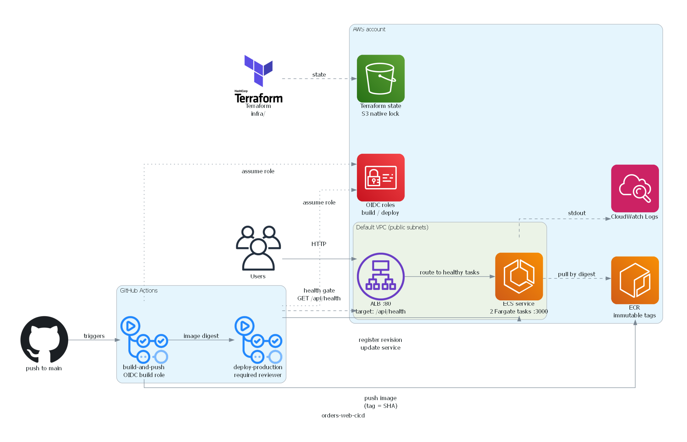

# orders-web-cicd

A Next.js orders service, modelled on the delivery practices of a mid-size product team. It is packaged with Docker and delivered to AWS by a GitHub Actions pipeline, with infrastructure defined in Terraform.

## What it demonstrates

- Building an image once and deploying that same artifact, referenced by digest
- Immutable image tags tied to commit SHAs
- Infrastructure as code with remote state and state locking
- Keyless CI access to AWS through OIDC, with no stored access keys
- Production deploys gated by a required reviewer
- A health gate that confirms the deployed version is serving before the deploy counts as successful

## Architecture



Terraform state lives in an S3 bucket with native locking (`use_lockfile`). A separate bootstrap stack creates that bucket and keeps its own local state, which stays out of the repository.

The diagram is generated from `docs/architecture.py` with the `diagrams` package.

## Pipeline

The workflow is `.github/workflows/build-and-deploy.yml`. It runs on every push to `main`.

1. **build-and-push** assumes a build role through OIDC, builds the image, tags it with the first seven characters of the commit SHA, pushes it to ECR, and outputs the image digest.
2. **deploy-production** runs in the `production` GitHub environment, so it waits for a required reviewer. It assumes a separate deploy role, registers a new ECS task revision that uses the digest and sets `APP_VERSION` to the SHA, updates the service, and waits for it to stabilise. It fails if the circuit breaker rolled back. It then polls `/api/health` through the load balancer until the new version is reported.

Only one production deploy runs at a time.

## Solved

| Concern | How |
|---|---|
| Inconsistent builds | One build per commit, tagged with SHA, deployed by digest |
| Unrecorded infrastructure | Terraform for ECR, networking, ALB, ECS, IAM, and OIDC |
| Long-lived CI credentials | OIDC roles trusted only for `main` and the `production` environment |

## Key decisions

- **Build once, deploy by digest.** Deploys reference the image's content hash, so a tag can't change what runs.
- **OIDC trust bound to the immutable subject.** The trust policy matches repository and owner IDs, so a repository recreated under the same name can't assume the role.
- **Two OIDC roles.** The build role can only push images. The deploy role can only update this service and pass the task roles to ECS, and only for the `production` environment.
- **Tasks in public subnets, no NAT gateway.** This avoids a fixed hourly cost. Tasks accept traffic only from the load balancer's security group.
- **Terraform ignores the service's task definition.** The pipeline owns the running revision, so a `terraform apply` can't undo a deploy.
- **Health endpoint is dynamic.** It would otherwise be prerendered at build time, freezing `APP_VERSION` into the image. Marking it dynamic reads the version per request.

## Repository layout

```
app/                        Next.js app, including app/api/health/route.ts
Dockerfile                  Multi-stage build; runs as a non-root user
.dockerignore
docs/
  architecture.py           Diagram source (AWS icons, via diagrams)
  architecture.png          Generated diagram
infra/
  bootstrap/                State bucket, applied once with local state
  versions.tf               Providers and the S3 backend
  providers.tf
  backend.hcl.example       Copy to backend.hcl and set the bucket name
  variables.tf
  ecr.tf                    Image repository and lifecycle policy
  network.tf                Security groups (default VPC)
  alb.tf                    Load balancer, target group, listener
  ecs.tf                    Cluster, task definition, service, roles
  github-oidc.tf            OIDC provider and the build and deploy roles
.github/workflows/
  build-and-deploy.yml      Build, push, and gated production deploy
```

## Setup

Prerequisites: an AWS account you control, Terraform 1.10 or later, Node.js 20 or later, Docker, and Git.

1. **Bootstrap the state bucket.** From `infra/bootstrap/`, run `terraform init`, then `terraform apply`. Copy the local `terraform.tfstate` somewhere outside the repository.
2. **Configure the backend.** Copy `infra/backend.hcl.example` to `infra/backend.hcl` and set `bucket` to the bootstrap output. This file is git-ignored.
3. **Set the trust subject.** In `infra/github-oidc.tf`, replace the placeholder subject with your own. To find the owner and repository IDs, run:
   ```bash
   gh api repos/OWNER/REPO/actions/oidc/customization/sub
   ```
4. **Create the registry first.** From `infra/`, run `terraform init -backend-config=backend.hcl`, then apply only the ECR resources with `-target`. Build and push an image tagged with a commit SHA.
5. **Apply the rest.** Set `initial_image_tag` to that SHA, then run `terraform apply` for the remaining files.
6. **Configure GitHub.** Under Settings → Secrets and variables → Actions → Variables, add `AWS_ROLE_ARN` (build role), `AWS_DEPLOY_ROLE_ARN` (deploy role), and `PRODUCTION_URL` (the ALB address, prefixed with `http://`). Under Settings → Environments, create `production` with yourself as a required reviewer.
7. **Push to `main`.** Approve the production deployment when it waits for review.

## Operating

- **Deploy:** merge to `main`, then approve the `production` deployment.
- **Tear down:** ECR cannot be deleted while it holds images. Empty the repository first, then run `terraform destroy` from `infra/`. Keep the bootstrap stack and state bucket, since they cost very little and hold the state history.
- **Costs:** the ALB and two Fargate tasks bill hourly while running. Roughly $35–45 per month if left on continuously, so destroy after each session. Check current AWS pricing before relying on these figures.